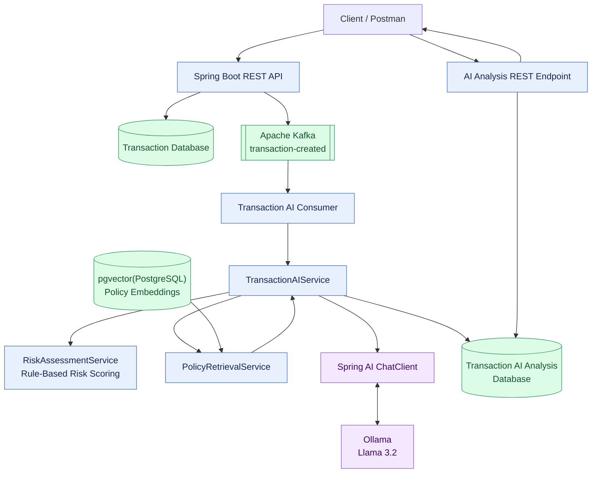
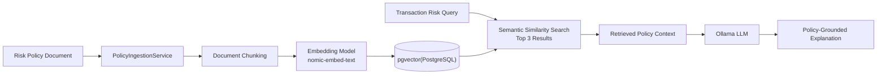
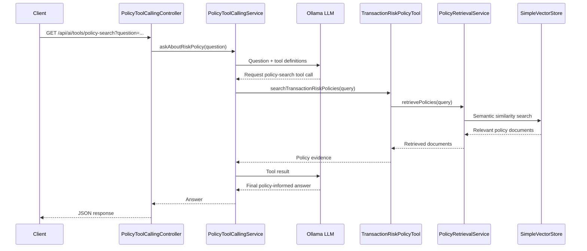

# AI-Powered Financial Transaction Risk Analysis System

An event-driven financial transaction application built with **Java, Spring Boot, Apache Kafka, Spring AI, and Ollama**. The system combines asynchronous transaction processing, rule-based risk assessment, Retrieval-Augmented Generation (RAG), and LLM tool calling to provide contextual, policy-informed transaction risk explanations.

## Architecture Overview

The application has two primary flows:

- **Transaction analysis flow:** Processes a transaction asynchronously, calculates its risk, retrieves relevant policies, generates an AI explanation, and persists the analysis.
- **Policy tool-calling flow:** Allows an LLM to invoke an application-defined Java tool to search risk policies and formulate an answer based on the retrieved evidence.

### High-Level Architecture

### Transaction Processing Flow

1. **Transaction submission:** The client submits transaction details through a Spring Boot REST API.
2. **Persistence and event publishing:** The application persists the transaction and publishes a transaction-created event to Apache Kafka.
3. **Asynchronous consumption:** The Kafka consumer receives the event and initiates AI-assisted transaction analysis.
4. **Risk assessment:** `RiskAssessmentService` evaluates transaction attributes using deterministic business rules and calculates a risk score and risk level.
5. **Policy retrieval:** `PolicyRetrievalService` searches the vector store for relevant risk-policy documents using semantic similarity.
6. **AI explanation:** Spring AI's `ChatClient` sends the transaction context, risk assessment, and retrieved policy evidence to Ollama running Llama 3.2.
7. **Analysis persistence:** The generated explanation and risk assessment are saved in the database.
8. **Result retrieval:** The client calls the AI-analysis endpoint to retrieve the persisted analysis without invoking the LLM again.

### RAG Pipeline

The system uses Retrieval-Augmented Generation to ground AI-generated explanations in the application's transaction risk policies.

**RAG components:**

- **PolicyIngestionService:** Loads policy documents, splits them into chunks, generates embeddings, and stores the resulting documents.
- **Embedding model:** `nomic-embed-text` generates vector representations for semantic search.
- **Vector store:** Spring AI's `SimpleVectorStore` stores and retrieves policy embeddings in memory.
- **PolicyRetrievalService:** Performs similarity searches and returns up to three relevant policy documents.
- **LLM:** Uses the retrieved policy context to produce a contextual risk explanation.

> **Note:** The current vector store is in-memory. Policy ingestion and vector data may need to be recreated when the application restarts, depending on the configured initialization lifecycle.

### LLM Tool-Calling Flow

The application also exposes policy retrieval as an LLM-callable tool using Spring AI's `@Tool` and `@ToolParam` annotations.

**Key components:**

- **TransactionRiskPolicyTool:** Exposes policy search as a Java method using `@Tool`.
- **`@ToolParam`:** Describes the query parameter so the LLM can generate an appropriate argument.
- **PolicyToolCallingService:** Registers the tool with `ChatClient` and coordinates the tool-calling interaction.
- **Spring AI:** Handles tool invocation and returns the tool result to the LLM for its final response.

The LLM can request the exposed tool when it determines that policy evidence is needed. The Java application executes the actual search and returns the result.

## Technology Stack

| Component | Technology |
|---|---|
| Language | Java |
| Backend framework | Spring Boot |
| Event streaming | Apache Kafka |
| AI integration | Spring AI |
| Local language model | Ollama — Llama 3.2 |
| Embedding model | nomic-embed-text |
| Retrieval approach | Retrieval-Augmented Generation (RAG) |
| Vector store | Spring AI SimpleVectorStore |
| API style | REST |
| Persistence | Application-configured relational database |

## API Overview

| Endpoint | Purpose |
|---|---|
| `POST /api/v1/transactions` | Submit a financial transaction |
| `GET /api/v1/transactions/{id}/ai-analysis` | Retrieve the persisted AI risk analysis |
| `GET /api/ai/tools/policy-search?question={question}` | Ask a policy question using LLM tool calling |

*Confirm the transaction endpoints against your current controller mappings before publishing this table.*

## Design Principles

- **Asynchronous processing:** Kafka decouples transaction submission from downstream AI analysis.
- **Separation of concerns:** Risk scoring, policy retrieval, LLM interaction, and persistence are handled by separate components.
- **Policy-grounded responses:** RAG supplies relevant policy evidence to reduce unsupported AI-generated claims.
- **Reusable application tools:** Spring AI tool calling connects the LLM to explicitly exposed Java functionality.
- **Separation of risk calculation and explanation:** Deterministic business rules calculate the risk assessment; the LLM explains the result using the available transaction context and policy evidence.

## Current Scope and Future Enhancements

The current implementation includes asynchronous transaction analysis, rule-based risk scoring, policy retrieval through RAG, persisted AI-generated explanations, and a policy-search tool exposed to the LLM.

Potential future enhancements include transaction-details tool calling, multi-tool workflows, persistent vector storage, improved failure handling, and stronger controls around retries and duplicate event processing.

## System Architectural Daigram
https://github.com/S-Rane/AI-Powered-Financial-Transaction-Risk-Analysis-System/blob/691bef995e9016d37b6df8653a592ec511930e86/AI-Powered%20Financial%20Risk%20Analysis%20Architecture.png

